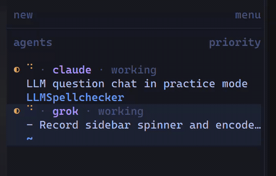

# Agent spinner

One-cell braille spinner on a Herdr Agents-sidebar row while that agent is working. Spaces rows stay static.



Herdr's own status mark does not animate. This plugin writes a display-only `$spin` token for panes whose `agent_status` is `working`, and clears it otherwise. The glyph is `#e0af68`.

Requires Herdr 0.9.0 or newer and `python3` on `PATH`.

## Install

```bash
git clone https://github.com/varvand/herdr-plugin-agent-spinner.git ~/.config/herdr/plugins/agent-spinner
herdr plugin link ~/.config/herdr/plugins/agent-spinner --enabled
```

Or install the GitHub checkout Herdr manages itself:

```bash
herdr plugin install varvand/herdr-plugin-agent-spinner
```

Draw the token on the agent row in `~/.config/herdr/config.toml`:

```toml
[ui.sidebar.agents]
rows = [
  ["state_icon", { token = "$spin", fg = "#e0af68", bold = true }, { token = "agent", fg = "#bb9af7", bold = true }, { token = "state_text", fg = "#565f89" }],
]
```

The startup hook detaches a single worker. A later Herdr start is a no-op while that worker still holds its lock. The frame refreshes about every 140ms and the token expires after 1.6s, so a dead worker disappears on its own.
